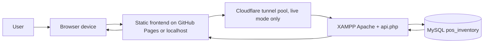

# Point of Sales & Inventory Management System

MySQL-backed POS and inventory system for a small food operation. The browser app is static; all business data lives in a local MySQL database. There is no cloud database and no Firebase.

## Repositories

| Repository | Contents |
|---|---|
| This public repo | Static frontend (`app/`), generated GitHub Pages site (`docs/`), and the Pages build script. No PHP, credentials, tunnel URLs, or customer data. |
| Private server repo | `api.php`, private config, database schema, PowerShell launchers, logs, and backups. Never publish its config or generated URL files. |

## How the system works

Local mode serves the frontend and API through XAMPP. Live mode publishes only the static frontend to GitHub Pages; the browser reaches the private API through a short-lived Cloudflare tunnel. The public build has no embedded API URL.

`start-live` opens up to five tunnels, saves the URL list in the private server folder, rebuilds the public site with an empty API config, and generates a seed URL. The seed URL carries a comma-separated API URL list; the browser saves it once and retries the next tunnel if one stops responding.

## Access

- Local frontend: XAMPP URL for `pos-inventory-management-system`
- Live frontend: <https://welbert23.github.io/pos-inventory-management-system/>
- API: private `api.php`, reached from localhost or a tunnel
- Database: MySQL database `pos_inventory`

Start/repair is handled by the private server launchers (`start-pos.bat`, `start-live.bat`, `stop-pos.bat`). Live access requires `cloudflared`.

## Roles

| Role | Access |
|---|---|
| Superadmin | Everything, including Users, DB tools, and full audit history |
| Client | POS, inventory, ingredients, customers, sales, reports, schedules; no Users or DB tools |
| Cashier | POS checkout, sales history, own time in/out; read-only catalog views |
| Inventory | Add/edit items and ingredients, stock in, recipes; no delete and no POS |

Role checks are enforced by `api.php`; buttons are also hidden in the frontend to match the role.

## Features

- **POS** — item search, category pills, cart, discounts, cash/change, order type, customer picker, checkout note, customer and kitchen receipts.
- **Customer picker** — searchable by name, phone, or email, with a pinned Walk-in / No customer option.
- **Checkout note** — fixed single-line field capped at 50 words; saved to MySQL and shown on receipts, Sales search, and CSV export.
- **FEFO deduction** — ingredient batches are consumed by nearest expiry first. One sale is written atomically with its items and stock changes.
- **Inventory & Ingredients** — dynamic categories, expiry/batch tracking, low-stock and expiry alerts, stock in, recipes, CSV export.
- **Sales** — history, search, receipt viewing, voiding by allowed roles, CSV export.
- **Customers** — customer records, order history, spend tier, and linked sales.
- **Attendance** — time in/out with lunch and coffee breaks, 2-week schedule cycle, late/absent/undertime flags.
- **Schedules** — Superadmin/Client set schedules; only Cashier and Inventory users can be scheduled.
- **Activity Log** — who, when, which action, and before/after values. Passwords are never sent to the browser.
- **Offline queue** — edits made while offline are queued locally and replayed through `save` on reconnect.
- **Reports** — inventory value and sales/cashier summaries for allowed roles.

## Frontend modules

| File | Purpose |
|---|---|
| `00-api-url.js` | Runtime API config; empty in the public Pages build |
| `00-core.js` | API URL resolution/fallback, helpers, MySQL sync, audit, token and migration helpers |
| `10-router-auth.js` | Navigation, login/logout |
| `20-dashboard.js` | Dashboard |
| `30-pos.js` | POS, cart, checkout, receipts |
| `40-inventory.js` | Inventory CRUD and stock |
| `45-recipes.js` | Item recipes / bill of materials |
| `50-ingredients.js` | Ingredients, expiry batches |
| `60-sales.js` | Sales history, void, CSV export |
| `70-customers.js` | Customers |
| `80-attendance.js` | Time in/out and schedules |
| `85-logs.js` | Activity Log |
| `90-reports.js` | Reports |
| `95-users.js` | User management |
| `96-modal.js` | Modal helpers |
| `99-init.js` | Bootstrap, loaded last |

`docs/` is generated from `app/` by `tools/build-pages.ps1`. Do not edit `docs/` by hand.

## Data and security

- Database: `pos_inventory` in local MySQL.
- Main tables: users, categories, meta, items, item_recipes, ingredients, customers, transactions, transaction_items, attendance, schedules, audit_log, login_attempts, revoked_tokens.
- Login is rate-limited. Log out revokes the token server-side; password resets bump `token_epoch` to sign out other sessions.
- `config.local.php`, generated URL files, logs, and backups stay in the private server repo.
- `file://` access is restricted to a small import-related action set and can be disabled in private config.

## Troubleshooting

| Symptom | What to do |
|---|---|
| Stale UI after an update | Hard refresh, or run the local launcher again |
| `DB offline — queued` | Start XAMPP/MySQL again; queued edits replay on reconnect |
| `Session expired` | Sign in again |
| Live URL 404/CORS | Run `start-live` again; tunnel URLs change on restart |
| No schedule flags | Set a schedule as Superadmin/Client first |

Detailed internal documentation lives alongside the repositories in the project's `Documentation` folder.
