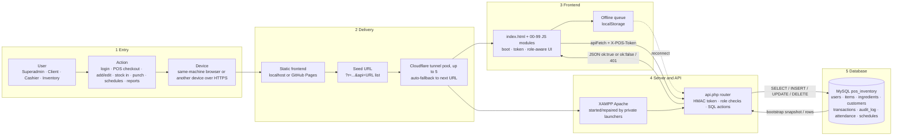

# Point of Sales & Inventory Management System

MySQL-backed POS and inventory system for a small food operation. The browser app is static; all business data lives in a local MySQL database. There is no cloud database and no Firebase.

## Repositories

| Repository | Contents |
|---|---|
| This public repo | Static frontend (`app/`), generated GitHub Pages site (`docs/`), and the Pages build script. No PHP, credentials, tunnel URLs, or customer data. |
| Private server repo | `api.php`, private config, database schema, PowerShell launchers, logs, and backups. Never publish its config or generated URL files. |

## How the system works

The functional flow has five stages: entry, delivery, frontend, API/server, and database. The same `api.php` and the same MySQL database are used in both local and live mode.

Local mode serves both the frontend and the API through XAMPP. Live mode publishes only the static frontend to GitHub Pages; the browser reaches the private API through a short-lived Cloudflare tunnel. The public build has no embedded API URL.

`start-live` starts up to five tunnels, saves the URL list in the private server folder, rebuilds the public site with an empty API config, and generates a seed URL. The seed URL carries a comma-separated API URL list. The browser saves that list once, cleans the address back to the short URL, and automatically tries the next tunnel if one stops responding.

### What each stage does

| Stage | Detail |
|---|---|
| Entry | A signed-in user performs an action from a browser. The role decides which buttons are visible. |
| Delivery | Local mode uses the XAMPP URL. Live mode uses the GitHub Pages build plus the tunnel pool. The seed URL is only needed once per device to store the API URL list. |
| Frontend | `00-api-url.js` and `00-core.js` resolve the API URL, attach the token, and call `apiFetch(action, payload)`. `99-init.js` runs `boot()`: show login without a token, otherwise call `bootstrap` and render the role-aware menu. |
| Server | Private launchers start/repair MySQL and Apache. `api.php` loads the private config, verifies the HMAC token and role, then runs one SQL action. |
| Database | MySQL is the source of truth. Bootstrap returns the full snapshot; writes update normalized tables inside a transaction. |

### API actions

| Action | Allowed role / scope | Result |
|---|---|---|
| `login` | Anyone with valid credentials | Rate-limited check; returns a signed 12-hour token. |
| `logout` | Signed-in user | Revokes the current token. |
| `bootstrap` | Signed-in user | Returns the full database snapshot for the UI. |
| `cashier_sale` | Superadmin, Client, Cashier | Atomic sale with FEFO ingredient deduction, transaction rows, and audit row. |
| `save` | Superadmin, Client, Inventory | Syncs the full snapshot in one transaction; also replays the offline queue. User rows are ignored unless Superadmin. |
| `audit` | Signed-in user | Writes one before/after activity row. |
| `logs` | Superadmin, Client | Reads recent activity history. |
| `schedules` / `schedule-save` | Read: signed-in user. Save: Superadmin, Client | Reads or writes the two-week schedule; only Cashier and Inventory users can be scheduled. |
| `attendance` / `punch` | Signed-in user | Reads role-scoped attendance or records the caller's own time in/out. |

### Two common flows

1. **Opening the app:** browser loads the static page → API URL list and token are resolved → `bootstrap` returns the MySQL snapshot → the router renders the Dashboard and only the menu buttons allowed for that role.
2. **Making a sale:** cart is confirmed → `cashier_sale` is posted → the API checks ingredient batches by nearest expiry, deducts stock, inserts the transaction and items, writes an audit row, and commits → the receipt and updated stock return to the browser.

If the API is unreachable, edits are queued in `localStorage` and the status chip shows `DB offline — queued`. On reconnect, the queue is posted through `save`, then a fresh `bootstrap` reloads the authoritative data.

## Access

- Local frontend: XAMPP URL for `pos-inventory-management-system`
- Live frontend: <https://welbert23.github.io/pos-inventory-management-system/>
- API: private `api.php`, reached from localhost or a tunnel
- Database: MySQL database `pos_inventory`

Start/repair is handled by the private server launchers (`start-pos.bat`, `start-live.bat`, `stop-pos.bat`). Live access requires `cloudflared`.

## Roles

| Role | Access |
|---|---|
| Superadmin | Everything, including Users, DB tools, and full audit history |
| Client | POS, inventory, ingredients, customers, sales, reports, schedules; no Users or DB tools |
| Cashier | POS checkout, sales history, own time in/out; read-only catalog views |
| Inventory | Add/edit items and ingredients, stock in, recipes; no delete and no POS |

Role checks are enforced by `api.php`; buttons are also hidden in the frontend to match the role.

## Main menu

These are the buttons shown in the sidebar:

- Dashboard
- Point of Sale
- Inventory
- Ingredients
- Sales History
- Customers
- Time In/Out
- Reports
- Users
- Activity Log

## Frontend modules

| File | Purpose |
|---|---|
| `00-api-url.js` | Runtime API config; empty in the public Pages build |
| `00-core.js` | API URL resolution/fallback, helpers, MySQL sync, audit, token and migration helpers |
| `10-router-auth.js` | Navigation, login/logout |
| `20-dashboard.js` | Dashboard |
| `30-pos.js` | POS, cart, checkout, receipts |
| `40-inventory.js` | Inventory CRUD and stock |
| `45-recipes.js` | Item recipes / bill of materials |
| `50-ingredients.js` | Ingredients, expiry batches |
| `60-sales.js` | Sales history, void, CSV export |
| `70-customers.js` | Customers |
| `80-attendance.js` | Time in/out and schedules |
| `85-logs.js` | Activity Log |
| `90-reports.js` | Reports |
| `95-users.js` | User management |
| `96-modal.js` | Modal helpers |
| `99-init.js` | Bootstrap, loaded last |

`docs/` is generated from `app/` by `tools/build-pages.ps1`. Do not edit `docs/` by hand.

## Data and security

- Database: `pos_inventory` in local MySQL.
- Main tables: users, categories, meta, items, item_recipes, ingredients, customers, transactions, transaction_items, attendance, schedules, audit_log, login_attempts, revoked_tokens.
- Login is rate-limited. Log out revokes the token server-side; password resets bump `token_epoch` to sign out other sessions.
- `config.local.php`, generated URL files, logs, and backups stay in the private server repo.
- `file://` access is restricted to a small import-related action set and can be disabled in private config.

## Glossary

Program terms used in this README and in the code:

| Term | Meaning |
|---|---|
| `app/` | Source frontend folder. `docs/` is the generated GitHub Pages copy. |
| `api.php` | The single private PHP endpoint and router for all API actions. |
| `apiFetch()` | Frontend helper that calls `api.php?action=...` and attaches the token. |
| `bootstrap` | Action that returns the full MySQL snapshot used to render the app. |
| `save` | Action that syncs the full snapshot into MySQL in one transaction; also replays the offline queue. |
| `cashier_sale` | Atomic sale action with FEFO ingredient deduction and audit write. |
| `FEFO` | First-expiring, first-out: ingredient batches are consumed by nearest expiry first. |
| `token` / `X-POS-Token` | Signed 12-hour credential sent with each request. |
| `bcrypt` / `HMAC-SHA256` | Password hashing and token signing used by the private API. |
| `token_epoch` | Per-user counter bumped on password reset to invalidate older sessions. |
| `role gate` | Server-side `requireRole()` check; frontend buttons are hidden to match. |
| `localStorage` | Browser storage for cached DB, token, URL list, and offline queue. |
| `offline queue` | Snapshot saved locally when the API is unreachable, then replayed on reconnect. |
| `seed URL` | One-time link carrying a comma-separated API URL list. |
| `tunnel pool` | Up to five short-lived Cloudflare HTTPS tunnels with automatic fallback. |
| `build-pages.ps1` | Script that copies `app/` to `docs/` and blanks the API config before publishing. |

## Troubleshooting

| Symptom | What to do |
|---|---|
| Stale UI after an update | Hard refresh, or run the local launcher again |
| `DB offline — queued` | Start XAMPP/MySQL again; queued edits replay on reconnect |
| `Session expired` | Sign in again |
| Live URL 404/CORS | Run `start-live` again; tunnel URLs change on restart |
| No schedule flags | Set a schedule as Superadmin/Client first |

Detailed internal documentation lives alongside the repositories in the project's `Documentation` folder.
