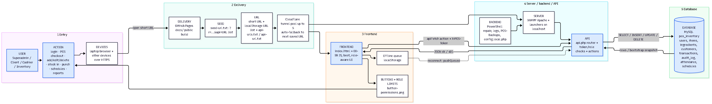
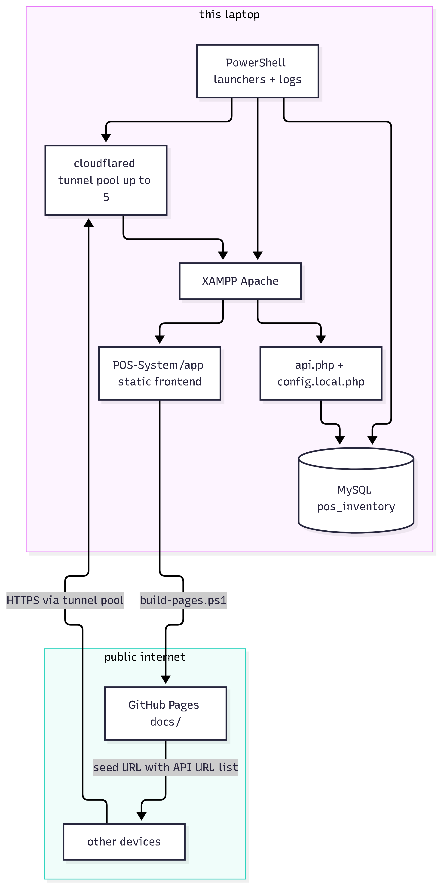
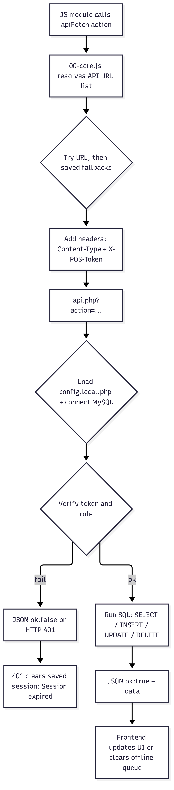
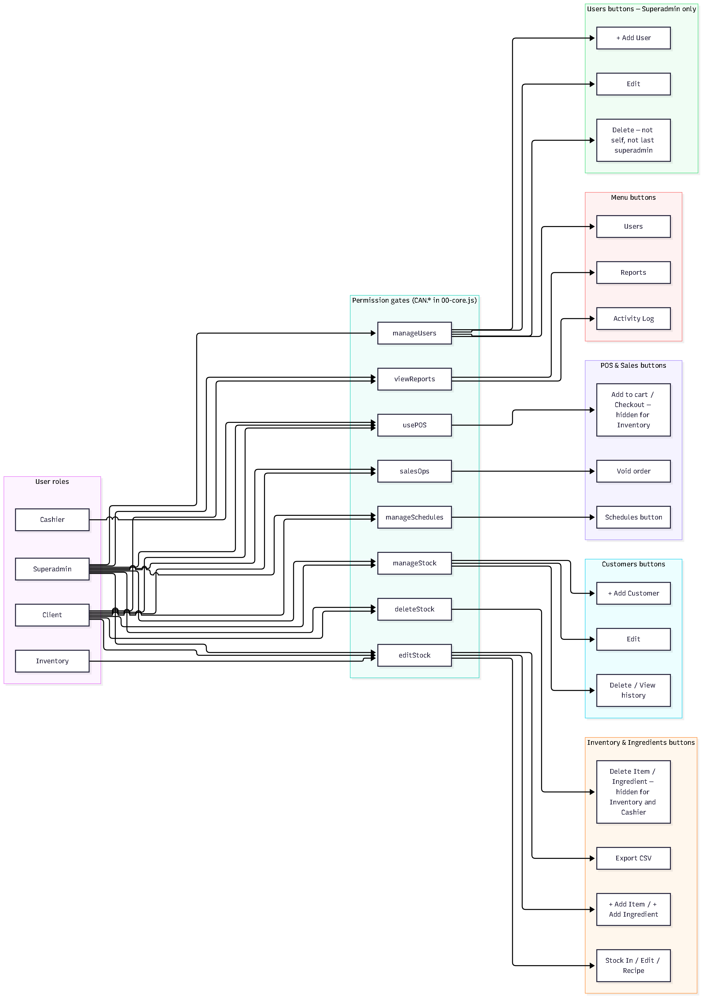
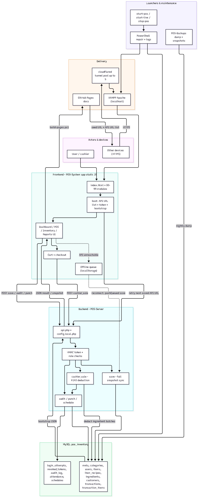
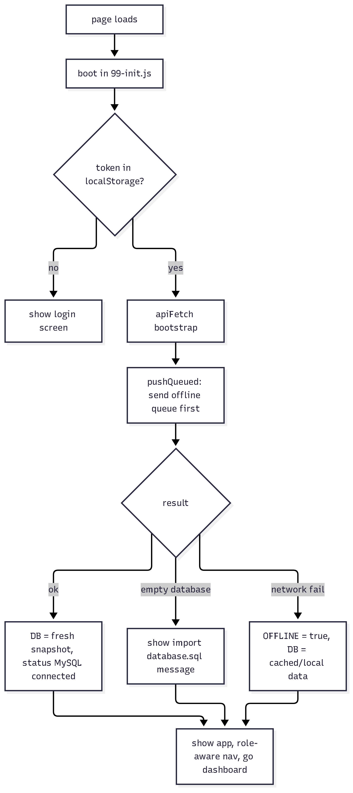
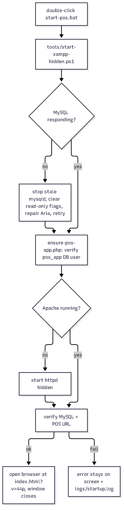
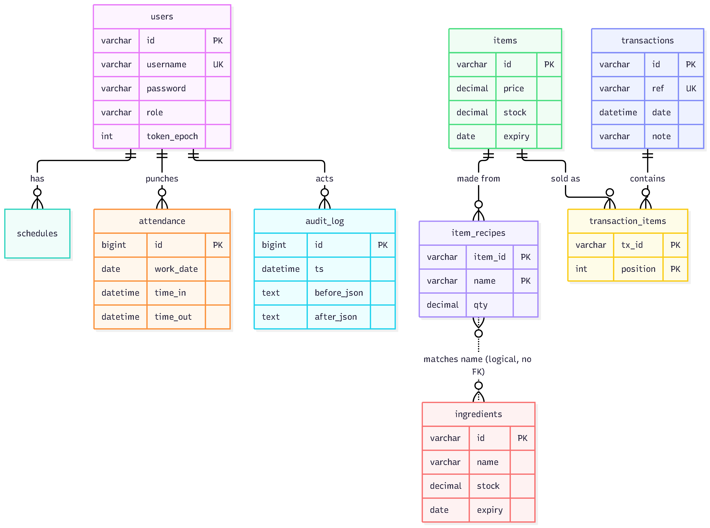
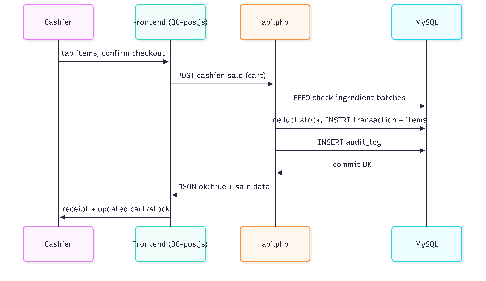

# Point of Sales & Inventory Management System

Full frontend documentation lives outside this repo at `..\Documentation\POS-SYSTEM-README.md` on this laptop.

Quick start: double-click `..\POS-Server\start-pos.bat` from the `POS System` folder.

## System at a glance

## API and role limits

More flows

### Full system workflow

### Frontend boot

### Backend local startup

### Database relationships

### Sale sequence

Images are 4K exports from `..\Documentation\Exports\Diagrams-4K`.
